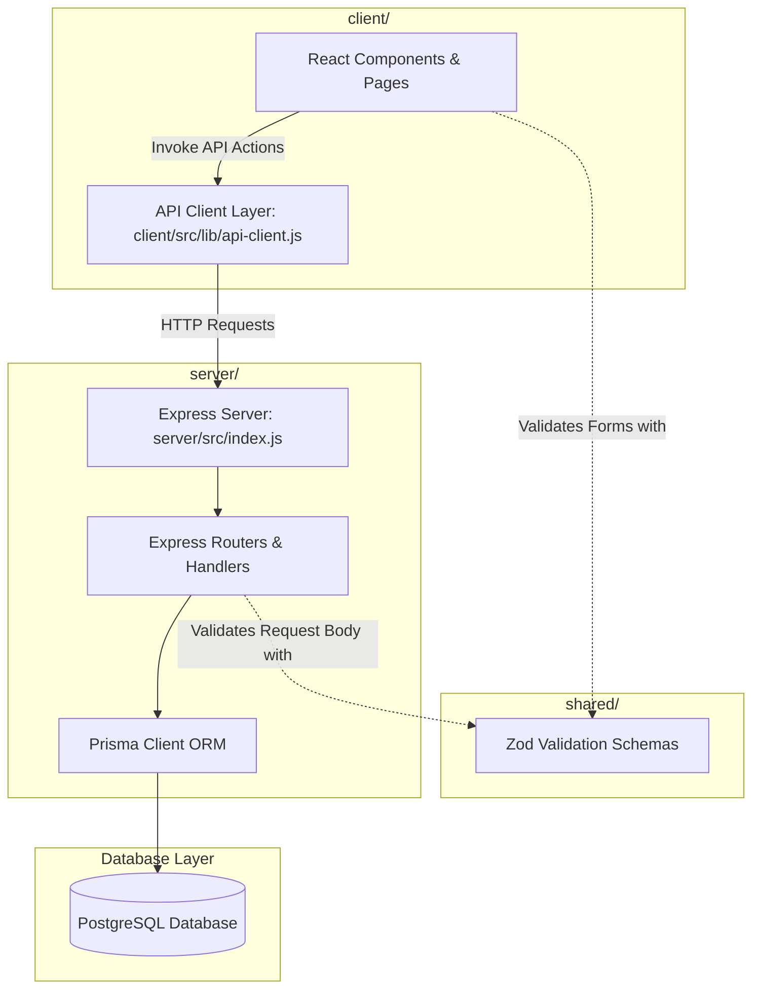

# MediFind — Online Medicine Search & Pharmacy Marketplace

MediFind is a full-stack web application that serves as a commerce platform and management hub for pharmacy onboarding, medicine search, inventory tracking, order management, and secure checkouts.

---

## Folder Structure Overview

```
MediFind Root/
├── frontend/                   # Frontend (React + Vite + JS)
│   ├── src/
│   │   ├── components/         # UI Elements
│   │   ├── lib/
│   │   │   └── api-client.js   # Centralized frontend API client
│   │   └── main.jsx            # Main app entrypoint and views
│   └── README.md               # Frontend detailed documentation
├── backend/                    # Backend (Node.js + Express + Prisma)
│   ├── src/
│   │   ├── common/
│   │   │   └── routes.js       # Centralized route registry
│   │   ├── routes/             # Route handlers
│   │   ├── middleware/         # Security and auth middleware
│   │   └── index.js            # App server entrypoint
│   └── README.md               # Backend detailed documentation
├── shared/                     # Shared package (Local package)
│   ├── src/
│   │   ├── schemas/            # Extracted Zod validation schemas
│   │   └── index.js            # Unified exports
│   └── package.json            # Workspace dependency declaration
└── pnpm-workspace.yaml         # PNPM workspace configurations
```

* For detailed frontend docs, see: [frontend/README.md](file:///c:/Users/vishwanath_cse/Documents/New%20project/frontend/README.md)
* For detailed backend docs, see: [backend/README.md](file:///c:/Users/vishwanath_cse/Documents/New%20project/backend/README.md)

---

## High-Level Architecture Diagram



---

## Tech Stack Summary Table

| Component | Technology | Description |
|---|---|---|
| **Frontend Framework** | React 18 + Vite 6 | Fast single-page application structure. |
| **Styling** | Tailwind CSS 3 | Utility-first styling for UI designs. |
| **Backend Framework** | Node.js + Express 4 | Lightweight and efficient REST API. |
| **Database ORM** | Prisma 6 | Type-safe schema definition and query builder. |
| **Validation Contracts** | Zod 3 | Schema-driven parsing on frontend & backend. |
| **Database** | PostgreSQL | Relational database for transaction storage. |
| **Security Headers** | Helmet | HTTP security headers reinforcement. |
| **Rate Limiter** | express-rate-limit | API endpoint abuse/flooding prevention. |

---

## Frontend & Backend Integration

The client connects to the server using the following flow:
1. **Base URL Configuration**: The frontend API client reads the target API URL from the `VITE_API_URL` environment variable (defaults to `http://localhost:4000/api/v1`).
2. **Authentication Flow**:
   - Upon successful login/register at `/auth/login` or `/auth/register`, the server returns a JWT access token and a refresh token.
   - The frontend stores the access token in `localStorage`.
   - The frontend API client (`api-client.js`) automatically appends this access token in the `Authorization: Bearer <token>` header for subsequent requests.
3. **Session Headers**: If the user has selected a specific medical store, the store ID is attached as the `x-shop-id` header to authorize actions against that specific shop's inventory.

---

## Local Development Setup

To run both the client and the server together in development mode, follow these steps:

### Prerequisites
* [Node.js](https://nodejs.org/) (v18 or higher recommended)
* `pnpm` workspace setup (run `npm install -g pnpm` if you do not have it, or execute through `npx pnpm`).

### Initial Workspace Hookup
From the project root:
```bash
# Install and link all workspace projects
pnpm install
```

### Running the Services

You can start both the client and server concurrently using the root package manager:
```bash
# Start both server and client in development mode
pnpm dev
```

Alternatively, you can run them in separate terminal windows:
```bash
# Run backend only
pnpm backend

# Run frontend only
pnpm frontend
```
